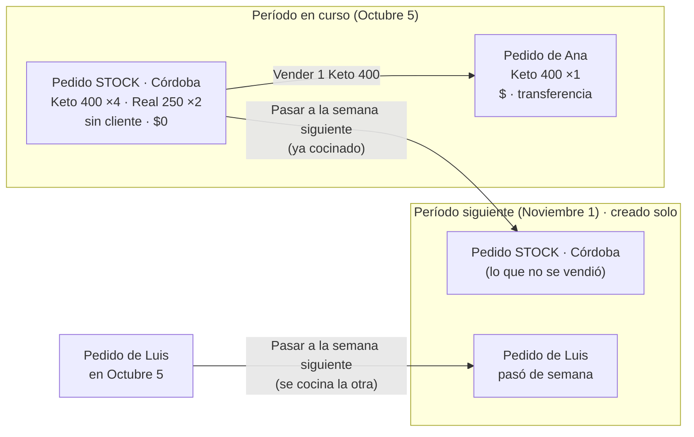

# Stock como pedido y períodos automáticos — plan (2026-10-30)

Estado: **plan, sin código**. Pendiente de las decisiones de la sección 8.

## 1. El problema

Hoy hay cuatro cosas distintas que, para quien opera, son "stock":

| Hoy                                    | Dónde vive                                | Dónde se ve     |
| -------------------------------------- | ----------------------------------------- | --------------- |
| Stock para el cierre (se cocina extra) | `production_stock` (período + ciudad)     | Cocina          |
| Excedente (lo cocinado de más)         | cálculo: real − pedido + stock − bajas    | Cocina, Pedidos |
| Bajas                                  | `surplus_writeoffs`                       | Cocina          |
| Stock de períodos anteriores           | `stock_lots` + `order_items.stock_lot_id` | Nuevo pedido    |
| Venta del stock del período            | pedido con `source = opportunity_sale`    | Pedidos         |

Cada una tiene sus reglas: cuándo pasa de una a otra, en qué ciudad está o cuánto queda. Cada
incidente de las últimas semanas salió de los pasos entre ellas: el stock que se pasaba de ciudad,
el excedente que no cuadraba o el lote que no aparecía.

Además, el período nace con el menú: si el menú de la semana que viene no está cargado, no hay
adónde mandar un pedido que se atrasó.

## 2. La idea

**Todo lo que se cocina es un pedido.** El stock es un pedido más, con dos diferencias: no tiene
cliente y no tiene valor. Venderlo es pasar viandas de ese pedido a uno de un cliente, que sí tiene
nombre, entrega, total y medio de pago.

**Los períodos existen solos.** El sistema mantiene creados el período en curso y el siguiente, con
el formato de siempre ("Noviembre 1"). El menú se carga después, dentro de un período que ya existe.
Así siempre hay una semana siguiente adonde **pasar** un pedido: uno atrasado, uno que el cliente
prefirió para la otra semana, o stock sin vender.

## 3. El modelo

### 3.1 Período automático

- `sales_cycles` deja de crearse con el menú. Una función idempotente, `ensureUpcomingCycles()`,
  garantiza que existan el período en curso y el siguiente. Se llama al pedir la lista de períodos
  y desde un cron diario de Vercel. Si dos llamadas compiten, el índice único del alias evita el
  duplicado.
- **Nombre:** mes y número de semana ("Noviembre 1"), con la regla de la sección 8.1.
- **Horarios:** se copian del último período corrido una semana (apertura, corte parcial de cocina
  y cierre). Si alguno hay que moverlo, por un feriado por ejemplo, se edita a mano.
- **Selección:** las pantallas siguen abriendo en el período en curso (`currentPeriod`). El
  siguiente aparece en el selector como "próximo".
- **Menú:** al crear un menú se **elige** el período, en vez de escribir el nombre. Un período puede
  no tener menú y aun así tener pedidos pasados de semana y stock.

### 3.2 Un pedido puede no tener menú

- `orders.weekly_menu_id` pasa a admitir `null`. Un pedido que pasa a una semana sin menú cargado
  conserva sus renglones con el nombre, el tamaño y el precio guardados en el pedido, que ya están
  en `order_items` (`product_name_snapshot`, `variant_snapshot`, `unit_price_minor`).
- `periodsFromMenus` deja de alcanzar para listar períodos. Hace falta `GET /api/v1/periods`, que
  hoy no existe.

### 3.3 Dónde se cocina cada renglón

Pasar un pedido de semana puede significar dos cosas distintas:

- **Ya está cocinado** (el reparto se atrasó, o es stock que no se vendió): no se vuelve a cocinar.
- **No se cocinó** (el cliente lo pidió para la otra semana): se cocina en el período nuevo.

Por eso cada renglón guarda **en qué período se cocina**, `order_items.production_cycle_id`. La
producción de un período es la suma de los renglones con ese período, sea cual sea el período del
pedido. Hoy las dos cosas coinciden siempre; con el pase de semana dejan de coincidir.

### 3.4 El pedido de stock

- `orders.kind`: `'customer'` (como hoy) o `'stock'`.
- Un pedido de stock **no tiene cliente** (`customer_id` admite `null` sólo con `kind = 'stock'`, con
  un `check`), ni domicilio, ni medio de pago, y su total es 0.
- **Uno por ciudad y por período**, como pidieron: "Stock · Córdoba · Octubre 5". Cargar más stock
  suma renglones o unidades a ese mismo pedido, no crea otro. Se garantiza con un índice único
  parcial (`kind = 'stock'`, período, ciudad).
- **Número:** con su propio prefijo (ej. `ST-CBA-0012`), así no consume números de pedido de cliente.
- **Cuenta en producción y etiquetas.** En la planilla de cocina va como "Stock" y la etiqueta sale
  sin nombre. **No cuenta en la contabilidad:** ventas, deudores, cobros, estadísticas de facturación
  ni el Excel de pedidos para cobrar.

### 3.5 Vender del stock

- En Nuevo pedido, el selector "Del stock" lista los renglones con disponible de **cualquier**
  pedido de stock vigente de la ciudad, del período o de períodos anteriores. Es lo mismo que hoy
  hacen "Sale del stock" y "Stock de períodos anteriores", juntos en una sola lista.
- El renglón vendido apunta al renglón de stock: `order_items.source_item_id`. Hereda su
  `production_cycle_id` (ya cocinado: no suma a producción) y toma el precio del menú vigente, o el
  guardado si el período no tiene menú.
- **Disponible de un renglón de stock** = unidades − dadas de baja − vendidas (los renglones de
  pedidos no cancelados que apuntan a él). Es la misma cuenta que hoy hacen los lotes, así que
  cancelar una venta devuelve la vianda sola.
- **Bajas:** `order_items.written_off_units` en el renglón de stock, con motivo en el historial.
- **Vencimiento:** el pedido de stock vence un mes después del cierre del período en que se cocinó,
  como los lotes de hoy. Vencido, deja de ofrecerse para vender.
- El panel "Stock disponible" de Pedidos pasa a leer esto mismo, y el botón "Vender" sigue igual.

### 3.6 Pasar a la semana siguiente

Es una acción del "⋯" de un pedido, de cliente o de stock:

1. Pregunta **"¿Ya está cocinado?"**, con el valor por defecto según el estado: un pedido LISTO o
   uno de stock vienen marcados; un borrador o un confirmado, no.
2. Mueve el pedido al período siguiente y recalcula la fecha de entrega con el día de reparto de
   siempre. Le saca el reparto (`delivery_run_id`) y le asigna el menú de ese período si ya existe.
3. Si no está cocinado, sus renglones pasan a cocinarse en el período nuevo.
4. Si es stock, sus renglones con disponible se suman al pedido de stock de la semana siguiente de
   esa ciudad, que se crea si no existe. Lo vendido queda donde estaba.
5. Queda en el historial del pedido: "Pasó de Octubre 5 a Noviembre 1 (ya cocinado)".

### 3.7 Pasar un pedido a stock (venta caída)

Es una acción del "⋯" de un pedido de cliente **no cobrado**. Un pedido cobrado primero se
reintegra o se desmarca como cobrado.

1. Pide el motivo, como al cancelar ("No lo retiró", "Se arrepintió"…).
2. El pedido queda **cancelado con ese motivo**, así la venta caída sigue figurando en las
   estadísticas de cancelaciones.
3. Sus renglones se suman al pedido de stock de su ciudad y su período, que se crea si no existe,
   con el mismo período de cocina. Si ya estaba cocinado, queda como stock listo para vender; si
   todavía no, se cocina igual, pero como stock.
4. Un Intuitivo conserva sus platos: se vende tal cual, como hoy los lotes de Intuitivo cancelados.
5. Reactivar el pedido devuelve las viandas desde el stock, si siguen disponibles. Si ya se
   vendieron, avisa cuáles faltan.

Reemplaza al "cancelado y pasó a stock" de hoy (`orders.cancelled_to_stock`, que crea un lote).
Ahora queda todo dentro del pedido de stock.

## 4. Qué pasa con lo que hay hoy

| Hoy                                       | Pasa a                                                                      |
| ----------------------------------------- | --------------------------------------------------------------------------- |
| `production_stock` (stock para el cierre) | renglones del pedido de stock del período y la ciudad                       |
| `surplus_writeoffs`                       | `written_off_units` en esos renglones                                       |
| `stock_lots` disponibles                  | renglones de un pedido de stock del período en que se cocinaron             |
| `order_items.stock_lot_id`                | `source_item_id` al renglón nuevo                                           |
| pedidos `opportunity_sale`                | quedan como están (histórico); los nuevos apuntan con `source_item_id`      |
| `orders.cancelled_to_stock` + su lote     | "Pasar a stock" (3.7): renglones al pedido de stock                         |
| excedente por coeficiente (cocina de más) | **decisión 8.4**                                                            |
| Cocina → "Stock para el cierre"           | "+ Stock" en Pedidos (o el mismo contador de Cocina, que carga el pedido)   |
| cierre de período que crea lotes          | ya no crea nada: el stock sin vender sigue en su pedido o se pasa de semana |

Las tablas viejas no se borran hasta que la versión nueva lleve un par de semanas en uso. Ese
borrado es la fase de "contraer" y deja sin sentido la 0078 pendiente del stock por ciudad.

## 5. Fases

Cada fase sale sola, en un momento fuera del cierre y del reparto. Va primero la migración, en su
propio commit, después la corrés vos y recién entonces sale el código.

| Fase | Qué                                                                                                                                | Migración                                                                                                   | Riesgo |
| ---- | ---------------------------------------------------------------------------------------------------------------------------------- | ----------------------------------------------------------------------------------------------------------- | ------ |
| 1    | **Períodos automáticos**: `ensureUpcomingCycles`, `GET /periods`, el menú elige el período                                         | ninguna, o una tabla de horarios si se decide 8.2                                                           | bajo   |
| 2    | **Pasar a la semana siguiente** (pedidos de cliente)                                                                               | `weekly_menu_id` admite `null`; `order_items.production_cycle_id` cargado con el período del pedido         | medio  |
| 3    | **Pedido de stock**: crear, cargar, ver en Pedidos, cocina y etiquetas, fuera de contabilidad                                      | `orders.kind`, `customer_id` admite `null` con `check`, `source_item_id`, `written_off_units`, índice único | alto   |
| 4    | **Vender del stock** desde los pedidos de stock; el panel y "Vender" pasan a leerlos. **Pasar un pedido no cobrado a stock** (3.7) | ninguna                                                                                                     | medio  |
| 5    | **Pasar lo existente**: `production_stock`, bajas y lotes a pedidos de stock; dejan de leerse                                      | backfill (probado en `migrations.test.ts`)                                                                  | alto   |
| 6    | **Contraer**: borrar `production_stock`, `surplus_writeoffs`, `stock_lots` y `opportunity_sale`                                    | drop                                                                                                        | bajo   |

Las fases 1 y 2 sirven solas, aunque el stock no cambie todavía. La 3 y la 4 conviene sacarlas
juntas o muy seguidas, para que no convivan dos maneras de vender stock.

## 6. Qué hay que revisar en cada fase (lo que más se rompe)

- **Producción y planilla de cocina:** hoy cuentan por período del pedido; pasan a contar por
  `production_cycle_id`. Hay que probar: pedido pasado ya cocinado (no suma), pedido pasado sin
  cocinar (suma en la nueva semana y deja de sumar en la vieja), stock vendido (no suma dos veces).
- **Contabilidad:** todas las consultas de ventas, deudores, cobros, estadísticas, el Excel y el
  reporte del período tienen que filtrar `kind = 'customer'`. Se busca cada `from(orders)` y se
  agrega un test por pantalla.
- **Clientes:** la ficha, "último pedido", repetir pedido y la búsqueda no pueden mostrar pedidos de
  stock.
- **Rutas y reparto:** un pedido de stock nunca entra a una hoja de ruta.
- **Números de pedido:** el contador de stock va aparte del de clientes.
- **Intuitivo pasado sin cocinar:** sus platos pueden no estar en el menú nuevo (decisión 8.5).

## 7. Cómo se ve

- **Pedidos:** la fila de stock aparece arriba de la lista, con una marca "Stock", la ciudad, el
  total de viandas y lo que queda ("Stock · Córdoba · 12 viandas · quedan 7"). Al abrirla se ven
  los renglones con lo vendido y lo que queda, y botones para vender, dar de baja y pasar de semana.
- **Nuevo pedido:** una sección "Del stock" con los renglones disponibles de cualquier período, con
  − / + como hoy. Reemplaza al tilde "Sale del stock" y a "Stock de períodos anteriores".
- **"+ Stock"** en Pedidos, al lado de "+ Nuevo pedido": se elige la variedad, el tamaño y la
  cantidad, y se suma al pedido de stock de la ciudad y el período.
- **Selector de período:** "Octubre 5 (en curso)" seleccionado, "Noviembre 1 (próximo)" disponible,
  aunque no tenga menú.

## 8. Decisiones pendientes

1. **Número de semana.** ¿A qué mes pertenece una semana que cruza de mes (lunes 27 de octubre a
   domingo 2 de noviembre)? Propuesta: al mes del **día de reparto**. Así "Noviembre 1" es la
   primera semana que reparte en noviembre.
2. **Horarios del período.** ¿Alcanza con copiar los del último período corrido una semana, o
   prefieren configurarlos (día y hora de cierre, de corte de cocina) en Configuración?
3. **Venta parcial.** Vender 1 de 4 Keto 400 crea el pedido del cliente y deja 3 en el de stock. Es
   lo que propongo. ¿Hay algún caso en que quieran convertir el pedido de stock entero en un pedido
   de cliente?
4. **Excedente por coeficiente.** Hoy la cocina produce un % de más que no es de nadie y aparece
   como excedente. Propuesta: que ese % se vuelva automáticamente un renglón del pedido de stock al
   generar la planilla, así todo lo que se cocina tiene un pedido. ¿O prefieren cargar el stock sólo
   a mano?
5. **Intuitivo que pasa de semana sin cocinar.** Si sus platos no están en el menú nuevo, ¿se
   cocinan igual los de antes, o se le pide al operador que los vuelva a elegir?
6. **Vencimiento.** ¿Sigue siendo un mes desde el cierre del período en que se cocinó?
7. **Cocina.** ¿El contador de "Stock para el cierre" se queda en Cocina (cargando el pedido de
   stock por detrás) o se carga sólo desde Pedidos?
