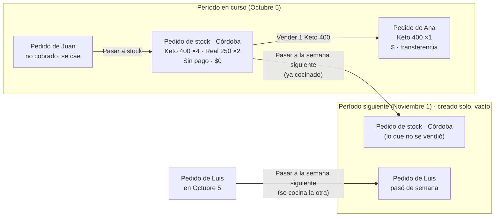

# Stock como pedido y períodos automáticos — plan (2026-10-30)

Estado: **plan con decisiones tomadas (2026-10-30), sin código.** Se trabaja **sólo en local**, en la
rama `stock-como-pedido`, sin subir a producción hasta que se decida.

## 1. El problema

Hoy hay cinco cosas distintas que, para quien opera, son "stock":

| Hoy                                    | Dónde vive                                | Dónde se ve     |
| -------------------------------------- | ----------------------------------------- | --------------- |
| Stock para el cierre (se cocina extra) | `production_stock` (período + ciudad)     | Cocina          |
| Excedente (lo cocinado de más)         | cálculo: real − pedido + stock − bajas    | Cocina, Pedidos |
| Bajas                                  | `surplus_writeoffs`                       | Cocina          |
| Stock de períodos anteriores           | `stock_lots` + `order_items.stock_lot_id` | Nuevo pedido    |
| Venta del stock del período            | pedido con `source = opportunity_sale`    | Pedidos         |

Cada una tiene sus reglas: cuándo pasa de una a otra, en qué ciudad está o cuánto queda. Cada
incidente de las últimas semanas salió de los pasos entre ellas: el stock que se pasaba de ciudad,
el excedente que no cuadraba o el lote que no aparecía.

Además, el período nace con el menú: si el menú de la semana que viene no está cargado, no hay
adónde mandar un pedido que se atrasó.

## 2. La idea

**Todo lo que se cocina es un pedido.** El stock es un pedido más: el de la ciudad, con forma de
pago **"Sin pago"** (valor 0, fuera de la contabilidad). Venderlo es pasar viandas de ese pedido a
uno de un cliente, que sí tiene nombre, entrega, total y medio de pago.

**El stock se carga siempre a mano.** Se elimina el coeficiente de excedente: la cocina produce lo
que suman los pedidos, incluido el de stock, y nada más.

**Los períodos existen solos.** El sistema mantiene creados el período en curso y el siguiente, con
el formato de siempre ("Noviembre 1"). Un período creado solo está **vacío**: no tiene menú, ni
platos, ni Intuitivos. Existe para tener adónde **pasar** algo del período anterior (stock sin
vender, un pedido atrasado, un cliente que lo quiere para la otra semana). El menú se carga después,
como hoy.

## 3. El modelo

### 3.0 Forma de pago "Sin pago"

Sirve sola, sin el resto del plan: pedidos de prueba, regalos, compensaciones o lo que sea que no
tiene que computar.

- Un medio de pago más en `payment_methods`, con código fijo `sin_pago`, creado por migración. No se
  puede borrar ni cambiar el código; sí el nombre que se muestra.
- Elegido, **el total del pedido es 0**: el servidor pone en 0 el precio de cada renglón, sin
  importar lo que mande el formulario. El formulario muestra $0 y pide un **motivo** ("Prueba",
  "Regalo", "Compensación"…), que queda en las notas.
- **Fuera de la contabilidad:** no es venta, no aparece en "Por cobrar" ni en deudores, no tiene
  tilde de cobrado y no entra a las rendiciones. **Sí cuenta en producción, cocina, etiquetas y
  reparto:** se cocina y se entrega como cualquier otro.
- En estadísticas aparece aparte: "N viandas sin pago (prueba, regalo, compensación)", para que se
  vea cuánto se da sin cobrar.
- Cambiar un pedido a "Sin pago" o sacarlo de ahí recalcula el total y queda en el historial.

### 3.1 Período automático

- `sales_cycles` deja de crearse con el menú. Una función idempotente, `ensureUpcomingCycles()`,
  garantiza que existan el período en curso y el siguiente. Se llama al pedir la lista de períodos
  y desde un cron diario de Vercel. Si dos llamadas compiten, el índice único del alias evita el
  duplicado.
- **Nombre:** mes del **día de reparto** y número de semana dentro de ese mes. "Noviembre 1" es la
  primera semana que reparte en noviembre. Se puede **cambiar el nombre desde Períodos**, como hoy.
- **Horarios:** se copian del último período corrido una semana (apertura, corte parcial de cocina
  y cierre). Si alguno hay que moverlo, por un feriado por ejemplo, se edita a mano.
- **Vacío:** el período creado solo no tiene menú ni platos. Los Intuitivos y los platos se declaran
  cuando se carga el menú, igual que hoy.
- **Selección:** las pantallas siguen abriendo en el período en curso (`currentPeriod`). El
  siguiente aparece en el selector como "próximo".
- **Menú:** al crear un menú se **elige** el período, en vez de escribir el nombre.

### 3.2 Un pedido puede no tener menú

- `orders.weekly_menu_id` pasa a admitir `null`. Un pedido que pasa a una semana sin menú cargado
  conserva sus renglones con el nombre, el tamaño y el precio guardados en el pedido, que ya están
  en `order_items` (`product_name_snapshot`, `variant_snapshot`, `unit_price_minor`).
- `periodsFromMenus` deja de alcanzar para listar períodos. Hace falta `GET /api/v1/periods`, que
  hoy no existe.

### 3.3 Dónde se cocina cada renglón

Pasar un pedido de semana puede significar dos cosas distintas:

- **Ya está cocinado** (el reparto se atrasó, o es stock que no se vendió): no se vuelve a cocinar.
- **No se cocinó** (el cliente lo pidió para la otra semana): se cocina en el período nuevo.

Por eso cada renglón guarda **en qué período se cocina**, `order_items.production_cycle_id`. La
producción de un período es la suma de los renglones con ese período, sea cual sea el período del
pedido. Hoy las dos cosas coinciden siempre; con el pase de semana dejan de coincidir.

### 3.4 El pedido de stock

Es un pedido común, con estas particularidades:

- **Cliente:** el cliente de sistema "Stock · Córdoba", uno por ciudad
  (`customers.is_system = true`). Así el pedido usa toda la maquinaria de siempre sin columnas que
  admitan `null`. Los clientes de sistema no aparecen en la lista de clientes, la búsqueda, el CRM
  ni las estadísticas de clientes.
- **Pago:** "Sin pago", fijo. Total 0 y fuera de la contabilidad (3.0).
- **Marca:** `orders.kind = 'stock'` (el resto, `'customer'`). Es lo que lo ofrece para vender, lo
  deja fuera de las hojas de ruta y lo muestra como "Stock" en la lista.
- **Uno por ciudad y por período:** "Stock · Córdoba · Octubre 5". Cargar más stock suma renglones
  o unidades a ese mismo pedido, no crea otro. Se garantiza con un índice único parcial
  (`kind = 'stock'`, período, ciudad).
- **Se carga a mano:** "+ Stock" en Pedidos (variedad, tamaño, cantidad). No hay coeficiente.
- **Cuenta en producción y etiquetas.** En la planilla de cocina va como "Stock" y la etiqueta sale
  sin nombre de cliente.

### 3.5 Vender del stock

- En Nuevo pedido, el selector "Del stock" lista los renglones con disponible de **cualquier**
  pedido de stock vigente de la ciudad, del período o de períodos anteriores. Reemplaza al tilde
  "Sale del stock" y a "Stock de períodos anteriores".
- El renglón vendido apunta al renglón de stock: `order_items.source_item_id`. Hereda su
  `production_cycle_id` (ya cocinado: no suma a producción) y toma el precio del menú vigente, o el
  guardado si el período no tiene menú.
- **Venta parcial:** vender 1 de 4 Keto 400 crea el pedido del cliente y deja 3 en el de stock.
- **Disponible de un renglón de stock** = unidades − dadas de baja − vendidas (los renglones de
  pedidos no cancelados que apuntan a él). Es la misma cuenta que hoy hacen los lotes, así que
  cancelar una venta devuelve la vianda sola.
- **Bajas:** `order_items.written_off_units` en el renglón de stock, con motivo en el historial.
- **Vencimiento:** un mes después del cierre del período en que se cocinó, como los lotes de hoy.
  Vencido, deja de ofrecerse para vender.
- El panel "Stock disponible" de Pedidos pasa a leer esto mismo, y el botón "Vender" sigue igual.

### 3.6 Pasar a la semana siguiente

Es una acción del "⋯" de un pedido, de cliente o de stock:

1. Pregunta **"¿Ya está cocinado?"**, con el valor por defecto según el estado: un pedido LISTO o
   uno de stock vienen marcados; un borrador o un confirmado, no.
2. Mueve el pedido al período siguiente y recalcula la fecha de entrega con el día de reparto de
   siempre. Le saca el reparto (`delivery_run_id`) y le asigna el menú de ese período si ya existe.
3. Si no está cocinado, sus renglones pasan a cocinarse en el período nuevo. Un Intuitivo sin
   cocinar **conserva la lista elegida**: sus platos viajan con el pedido (sección 8).
4. Si es stock, sus renglones con disponible se suman al pedido de stock de la semana siguiente de
   esa ciudad, que se crea si no existe. Lo vendido queda donde estaba.
5. Queda en el historial del pedido: "Pasó de Octubre 5 a Noviembre 1 (ya cocinado)".

### 3.7 Pasar un pedido a stock (venta caída)

Es una acción del "⋯" de un pedido de cliente **no cobrado**. Un pedido cobrado primero se
desmarca como cobrado.

1. Pide el motivo, como al cancelar ("No lo retiró", "Se arrepintió"…).
2. El pedido queda **cancelado con ese motivo**, así la venta caída sigue figurando en las
   estadísticas de cancelaciones.
3. Sus renglones se suman al pedido de stock de su ciudad y su período, que se crea si no existe,
   con el mismo período de cocina. Si ya estaba cocinado, queda como stock listo para vender; si
   todavía no, se cocina igual, pero como stock.
4. Un Intuitivo conserva sus platos y se vende tal cual, como hoy los lotes de Intuitivo cancelados.
5. Reactivar el pedido devuelve las viandas desde el stock, si siguen disponibles. Si ya se
   vendieron, avisa cuáles faltan.

Reemplaza al "cancelado y pasó a stock" de hoy (`orders.cancelled_to_stock`, que crea un lote).

## 4. Qué pasa con lo que hay hoy

| Hoy                                       | Pasa a                                                                      |
| ----------------------------------------- | --------------------------------------------------------------------------- |
| `production_stock` (stock para el cierre) | renglones del pedido de stock del período y la ciudad                       |
| `surplus_writeoffs`                       | `written_off_units` en esos renglones                                       |
| `stock_lots` disponibles                  | renglones de un pedido de stock del período en que se cocinaron             |
| `order_items.stock_lot_id`                | `source_item_id` al renglón nuevo                                           |
| pedidos `opportunity_sale`                | quedan como están (histórico); los nuevos apuntan con `source_item_id`      |
| `orders.cancelled_to_stock` + su lote     | "Pasar a stock" (3.7): renglones al pedido de stock                         |
| coeficiente y excedente calculado         | **se eliminan**: `surplus_configs`, su pantalla y la columna de excedente   |
| Cocina → "Stock para el cierre"           | "+ Stock" en Pedidos                                                        |
| cierre de período que crea lotes          | ya no crea nada: el stock sin vender sigue en su pedido o se pasa de semana |

Las tablas viejas no se borran hasta que la versión nueva lleve un par de semanas en uso. Ese
borrado es la fase de "contraer" y deja sin sentido la 0078 pendiente del stock por ciudad.

## 5. Fases

Por ahora todo queda en local, en la rama `stock-como-pedido`. Cuando se decida subir, cada fase sale
sola, fuera del cierre y del reparto: primero la migración en su propio commit, la corrés vos en
producción y recién entonces sale el código.

| Fase | Qué                                                                                              | Migración                                                                                    | Riesgo |
| ---- | ------------------------------------------------------------------------------------------------ | -------------------------------------------------------------------------------------------- | ------ |
| 0    | **"Sin pago"** (3.0): total 0, motivo, fuera de la contabilidad, aparte en estadísticas          | insertar `sin_pago` en `payment_methods`                                                     | bajo   |
| 1    | **Períodos automáticos** (3.1): `ensureUpcomingCycles`, `GET /periods`, el menú elige el período | ninguna                                                                                      | bajo   |
| 2    | **Pasar a la semana siguiente** (3.2, 3.3, 3.6)                                                  | `weekly_menu_id` admite `null`; `order_items.production_cycle_id`, cargado con el del pedido | medio  |
| 3    | **Pedido de stock** (3.4): clientes de sistema, "+ Stock", cocina y etiquetas; sin coeficiente   | `orders.kind`, `customers.is_system`, `source_item_id`, `written_off_units`, índice único    | alto   |
| 4    | **Vender del stock** (3.5) y **pasar un pedido no cobrado a stock** (3.7)                        | ninguna                                                                                      | medio  |
| 5    | **Pasar lo existente**: `production_stock`, bajas y lotes a pedidos de stock; dejan de leerse    | backfill (probado en `migrations.test.ts`)                                                   | alto   |
| 6    | **Contraer**: borrar `production_stock`, `surplus_writeoffs`, `surplus_configs` y `stock_lots`   | drop                                                                                         | bajo   |

La 0 sirve sola desde ya. La 1 y la 2 sirven aunque el stock no cambie todavía. La 3 y la 4 van
juntas o muy seguidas, para que no convivan dos maneras de vender stock.

## 6. Qué hay que revisar en cada fase (lo que más se rompe)

- **Producción y planilla de cocina:** hoy cuentan por período del pedido; pasan a contar por
  `production_cycle_id`. Hay que probar: pedido pasado ya cocinado (no suma), pedido pasado sin
  cocinar (suma en la nueva semana y deja de sumar en la vieja), stock vendido (no suma dos veces).
- **Contabilidad:** todas las consultas de ventas, deudores, cobros, estadísticas, el Excel y el
  reporte del período tienen que dejar afuera "Sin pago". Se busca cada `from(orders)` y se agrega
  un test por pantalla.
- **Clientes:** los clientes de sistema no pueden aparecer en la ficha, la búsqueda, el CRM ni las
  estadísticas de clientes.
- **Rutas y reparto:** un pedido de stock nunca entra a una hoja de ruta. Uno "Sin pago" de cliente
  sí (un regalo se entrega).
- **Números de pedido:** el de stock lleva su propio prefijo, para no consumir números de clientes.

## 7. Cómo se ve

- **Pedidos:** la fila de stock aparece arriba de la lista, con una marca "Stock", la ciudad, el
  total de viandas y lo que queda ("Stock · Córdoba · 12 viandas · quedan 7"). Al abrirla se ven
  los renglones con lo vendido y lo que queda, y botones para vender, dar de baja y pasar de semana.
- **Nuevo pedido:** una sección "Del stock" con los renglones disponibles de cualquier período, con
  − / + como hoy. En "Medio de pago", la opción "Sin pago" pone el total en $0 y pide el motivo.
- **"+ Stock"** en Pedidos, al lado de "+ Nuevo pedido".
- **Selector de período:** "Octubre 5 (en curso)" seleccionado, "Noviembre 1 (próximo)" disponible,
  aunque no tenga menú.

## 8. Decisiones

Tomadas el 2026-10-30:

1. **Nombre del período:** mes del día de reparto y número de semana. Se puede renombrar desde
   Períodos.
2. **Horarios:** se copian del último período corrido una semana.
3. **Venta parcial:** el pedido del cliente se lleva lo vendido; el resto queda en el de stock.
4. **Coeficiente:** se elimina. El stock se carga siempre a mano.
5. **Período automático vacío:** sin menú, sin platos, sin Intuitivos. Existe para recibir lo que
   se pasa del período anterior.
6. **Stock por ciudad:** un pedido más, con "Sin pago".
7. **"Sin pago":** forma de pago de valor 0 para lo que no computa (prueba, regalo, compensación).

Por confirmar:

- **Intuitivo que pasa de semana sin cocinar:** decidido (2026-10-30): conserva la lista elegida. Si hace falta cargar un Intuitivo de una semana anterior, se carga desde esa semana.
- **Vencimiento del stock:** se mantiene en un mes desde el cierre del período en que se cocinó.

## 9. Stock viejo: absorción y convivencia (aprobado el 2026-10-30)

Hay **cinco formas** de stock cargado, no dos: pedidos del cliente "STOCK" (el método más viejo: con
precio, en rutas y etiquetas, excluidos de estadísticas por el nombre), `production_stock`,
`surplus_writeoffs`, `stock_lots` (con viandas ya vendidas por `order_items.stock_lot_id`) y las
ventas `opportunity_sale` / `cancelled_to_stock`, que son historial.

**Paso 0 — diagnóstico.** `packages/db/scripts/diagnose-stock-legacy.sql`, de sólo lectura (corre en
una transacción `READ ONLY` que termina en `ROLLBACK`). Lo corre el equipo en Neon y muestra cuánto
hay de cada forma, por período y ciudad, qué está vencido, qué ya se vendió, qué pedidos del STOCK
siguen vivos y los controles que la migración tiene que contemplar. Probado en
`diagnose-stock-legacy.test.ts`.

**Una sola fuente de verdad por período (corte).** Lo nuevo y lo viejo nunca cuentan a la vez en
producción: los períodos anteriores al corte siguen leyendo el stock viejo; desde el período de corte
la producción lee sólo los pedidos de stock. El panel viejo de Cocina sigue visible en la transición,
pero escribe en el pedido de stock por detrás; después se borra.

**Absorción** (en la migración del corte):

- lotes con disponible → renglones del pedido de stock de su período y ciudad, con lo que queda; lo
  vendido sigue en sus pedidos;
- `production_stock` y bajas del período abierto → renglones (y `written_off_units`) del pedido de
  stock de ese período;
- pedidos del cliente "STOCK": los de períodos terminados se marcan como stock (las estadísticas ya
  los excluían); los vivos quedan para resolver;
- **las tablas viejas no se tocan:** cada renglón nuevo guarda de qué registro salió
  (`legacy_source`), para comparar y poder volver atrás;
- se ensaya en `migrations.test.ts` y sobre una copia de la base (un respaldo), comparando por
  período y ciudad que los totales de producción y de stock den igual antes y después.

**Bandeja "Stock heredado para resolver"**, arriba de Pedidos: todo lo absorbido queda "a revisar",
con acciones vender (a un cliente, cobrado o no), pasar al período siguiente, dar de baja (con
motivo; no se borra), dejar como stock, y para un pedido "STOCK" con importe, pasarlo a "Sin pago" o
asignarlo a un cliente real. Hasta que se vacíe no se borra nada viejo.

**Orden** (reemplaza las fases 3 a 6 de la sección 5):

1. Fase 0 ("Sin pago") y diagnóstico: no tocan producción.
2. Fases 1 y 2 (períodos automáticos, pasar de semana).
3. Pedido de stock y venta desde el stock, en local, sin corte.
4. Migración de corte y absorción, ensayada sobre un respaldo; el corte se elige fuera del cierre y
   del reparto.
5. Bandeja de stock heredado.
6. Contraer: borrar las tablas viejas y el panel de Cocina después de un par de semanas sin
   diferencias.
